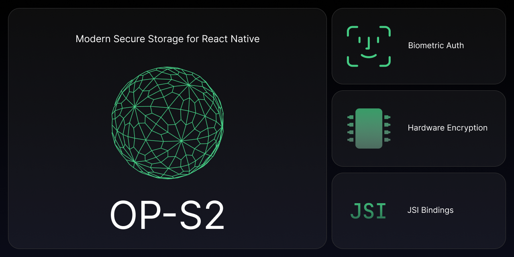

<pre align="center">yarn add @op-engineering/op-s2</pre>

<div align="center">
  <a align="center" href="https://github.com/ospfranco?tab=followers">
    
  </a>
  <br />
  <a align="center" href="https://twitter.com/ospfranco">
    
  </a>
</div>
<br />

---

Modern encryption module for React Native. Uses `Keychain` on iOS and the [official libraries](https://developer.android.com/jetpack/androidx/releases/security), `KeyStore`/`EncryptedSharedPreferences`, on Android.

Created by [ospfranco](https://github.com/sponsors/ospfranco).

Join the Discord

https://discord.gg/W9XmqCQCKP

## Motivation

Other React Native stores hand-roll their encryption, via OpenSSL (does not use hardware when possible) or raw implementation of algorithms (outdated algorithms or improper implementations).

The benefit of using the official implementations is the use of encryption hardware on-device when possible. Using the hardware chips provides yet another layer of security to prevent tampering with the data as it is being decrypted/encrypted/stored.

## Examples

```ts
import { get, set, ACCESSIBILITY } from '@op-engineering/op-s2';

const { error } = set({
  key: 'myKey',
  value: 'myValue',
  // Only valid for iOS you have more control when to prompt for authentication
  accessibility: ACCESSIBILITY.WHEN_PASSCODE_SET_THIS_DEVICE_ONLY,
  // OR works for both iOS and Android
  withBiometrics: true,
  // Optional — customize the biometric / device-credential prompt
  biometricPrompt: {
    title: 'Unlock to continue',
    subtitle: 'Authenticate to access your data',
    negativeButtonText: 'Cancel',
    allowDeviceCredential: true,
    allowBiometricWeak: false,
  },
});

const { error, value } = get({
  key: 'myValue',
  withBiometrics: true,
  biometricPrompt: {
    title: 'Unlock to read',
    allowDeviceCredential: true,
  },
});

const { error } = del({
  key: 'myValue',
  withBiometrics: true,
  biometricPrompt: {
    title: 'Unlock to delete',
  },
});
```

### iOS Accessibility

On iOS you can specify an accessibility value which allows you to customize when the data is readable. It is mutually exclusive with `withBiometrics`. So pick one or the other.

| Key                                 | Explanation                                                                                                                                                                                       |
| ----------------------------------- | ------------------------------------------------------------------------------------------------------------------------------------------------------------------------------------------------- |
| AFTER_FIRST_UNLOCK                  | The data in the keychain item cannot be accessed after a restart until the device has been unlocked once by the user. This may be useful if you need to access the item when the phone is locked. |
| AFTER_FIRST_UNLOCK_THIS_DEVICE_ONLY | Similar to AFTER_FIRST_UNLOCK, except the entry is not migrated to a new device when restoring from a backup.                                                                                     |
| ALWAYS                              | The data in the keychain item can always be accessed regardless of whether the device is locked. This is the least secure option.                                                                 |
| ALWAYS_THIS_DEVICE_ONLY             | Similar to ALWAYS, except the entry is not migrated to a new device when restoring from a backup.                                                                                                 |
| WHEN_PASSCODE_SET_THIS_DEVICE_ONLY  | Similar to WHEN_UNLOCKED_THIS_DEVICE_ONLY, except the user must have set a passcode to store an entry. If the user removes their passcode, the entry will be deleted.                             |
| WHEN_UNLOCKED                       | The data in the keychain item can be accessed only while the device is unlocked by the user.                                                                                                      |
| WHEN_UNLOCKED_THIS_DEVICE_ONLY      | Similar to WHEN_UNLOCKED, except the entry is not migrated to a new device when restoring from a backup.                                                                                          |

### With biometrics

When using biometric info you need to include `NSFaceIDUsageDescription` in your info.plist, which will prompt the user for permission to use faceID.

#### Customizing the prompt

Pass a `biometricPrompt` object to `set` / `get` / `del` to customize the auth UI and choose which authenticators are accepted:

| Field                   | Description                                                                                                                                                                                   | Default                 |
| ----------------------- | --------------------------------------------------------------------------------------------------------------------------------------------------------------------------------------------- | ----------------------- |
| `title`                 | Prompt title                                                                                                                                                                                  | `"Please authenticate"` |
| `subtitle`              | Prompt subtitle. iOS has no native subtitle slot so it is appended to the title.                                                                                                              | `""`                    |
| `negativeButtonText`    | Label of the negative (cancel) button. Omitted on Android when `allowDeviceCredential: true` because the device-credential button takes that slot on API < 30.                                | `"Cancel"`              |
| `allowDeviceCredential` | Allow the device passcode (PIN/pattern/password) as an alternative to biometrics. On iOS adds `kSecAccessControlDevicePasscode`; on Android OR's in `DEVICE_CREDENTIAL`.                      | `false`                 |
| `allowBiometricWeak`    | Allow Class 2 (weak) biometrics. On iOS uses `kSecAccessControlBiometryAny` instead of `kSecAccessControlBiometryCurrentSet`; on Android uses `BIOMETRIC_WEAK` instead of `BIOMETRIC_STRONG`. | `false`                 |

The resulting Android authenticator combinations are:

| `allowDeviceCredential` | `allowBiometricWeak` | Android `BiometricManager.Authenticators` |
| ----------------------- | -------------------- | ----------------------------------------- |
| `false`                 | `false`              | `BIOMETRIC_STRONG`                        |
| `true`                  | `false`              | `BIOMETRIC_STRONG \| DEVICE_CREDENTIAL`   |
| `false`                 | `true`               | `BIOMETRIC_WEAK`                          |
| `true`                  | `true`               | `BIOMETRIC_WEAK \| DEVICE_CREDENTIAL`     |

If you pass `withBiometrics: true` without a `biometricPrompt` object at all, the prompt falls back to the defaults listed above.

### iOS Service and Access Group

On iOS, an item is identified by its `key`, a keychain service and an access group. `service` and `accessGroup` are both optional. If omitted, the service is the app's bundle identifier and no access group is set.

| Option        | Explanation                                                                                                                                                                                                                                                       | Default                     |
| ------------- | ----------------------------------------------------------------------------------------------------------------------------------------------------------------------------------------------------------------------------------------------------------------- | --------------------------- |
| `service`     | The keychain service (`kSecAttrService`).                                                                                                                                                                                                                         | The app's bundle identifier |
| `accessGroup` | The keychain access group (`kSecAttrAccessGroup`). The app (and any extension reading the item) must list it in its `keychain-access-groups` entitlement, or use an app group ID (`group.*`) it has. Otherwise the call fails with `[op-s2] Missing entitlement`. | None (see below)            |

#### Sharing an item with an app extension

Pass both options explicitly, with the same values in the app and in the extension:

```ts
const scope = {
  // The extension has its own bundle identifier, so the default service
  // would differ between the two. Pin it to one value.
  service: 'com.example.app',
  // An app group (or keychain access group) both targets are entitled to.
  accessGroup: 'group.com.example.app',
};

set({ key: 'token', value: 'secret', ...scope });
const { value } = get({ key: 'token', ...scope });
del({ key: 'token', ...scope });
```

#### Notes

- Empty strings are treated as unset.
- If you pass `service` or `accessGroup` for an item, pass the same values in every `set`, `get` and `del` call for it:
  - With a different `service`, the item isn't found.
  - Without `accessGroup`, the call isn't limited to one group. A `set` or `del` then also deletes the copy stored in your shared group, and a `get` may return a copy from another group.
- If the default `service` can't be determined (a nil bundle identifier), or a given `service` or `accessGroup` can't be converted, the operation returns an `error` rather than running a query that matches every service or group.
- A non-string `service` or `accessGroup` is rejected rather than silently using the default scope, on both platforms: `set` returns an `error`, and `get` and `del` throw, as they do for a missing `key`.
- Otherwise both options are ignored on Android, where items are always private to the app.
- If you've never passed either option, upgrading changes nothing: items saved by earlier versions of op-s2 are still found.

## Secure Enclave

The library already uses the [Secure Enclave](https://support.apple.com/en-gb/guide/security/sec59b0b31ff/web) to encrypt the data before saving it on the keychain. However, it is not possible to store data directly on the Secure Enclave as it is meant to store the private part of asymmetrical keys, meaning data saved there cannot be retrieved to user space.

## Android Quirks

The official Android crypto implementation uses hardware-backed-up encryption when possible. However, it will depend on the vendor to use the hardware chips or not, there is not much that can be done about that.

The library currently depends on the latest available versions and is periodically updated to support fixes and updates.

## TODO

- [-] Add `getAllKeys`, `getAllItems` and `deleteAllItems` methods (Not possible on iOS)
- [ ] Device testing list
- [ ] Security audits

## License

MIT License
